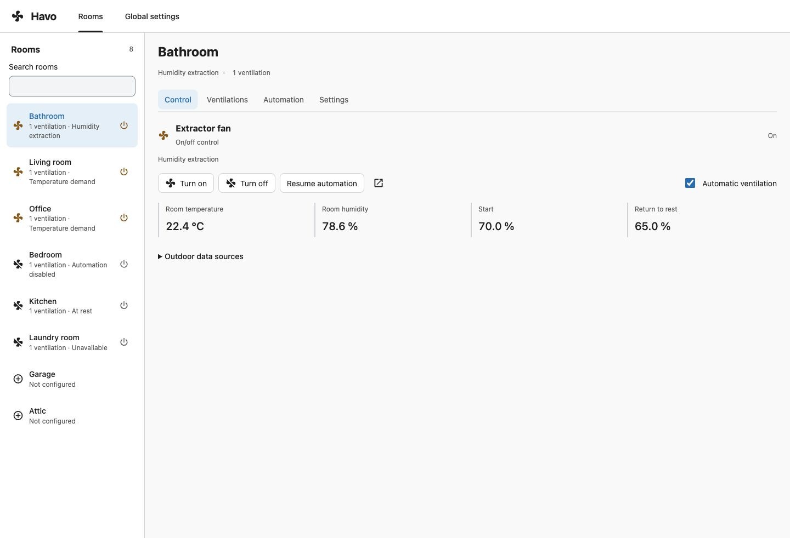
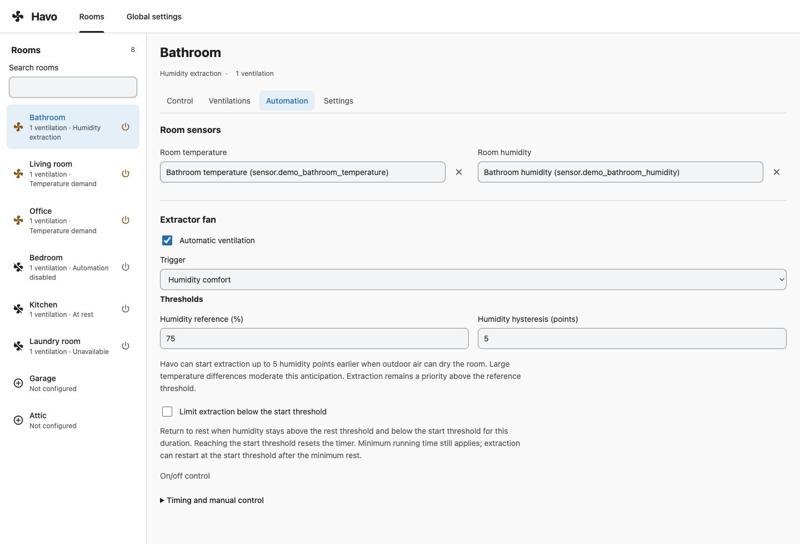
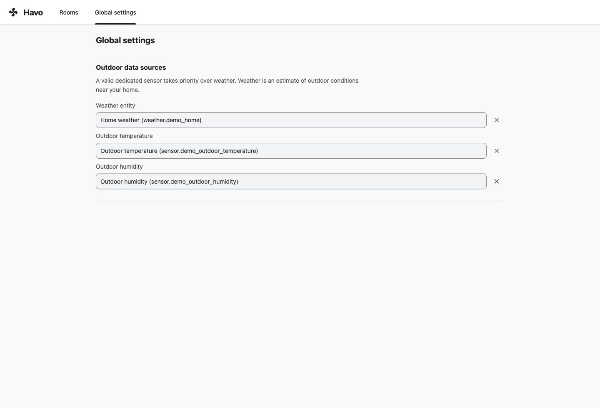

<p align="center">
  
</p>

# Havo - Home Assistant Ventilation Orchestrator

[](https://github.com/Gnol86/Havo/releases/latest)
[](https://my.home-assistant.io/redirect/hacs_repository/?owner=Gnol86&repository=Havo&category=integration)
[](https://github.com/Gnol86/Havo)

**Ventilation that follows your home, room by room.**

Havo is a custom Home Assistant integration that brings temperature control, adaptive humidity extraction and your existing fans together in one place. Configure your rooms from a dedicated sidebar panel, let Havo handle everyday ventilation, and take control whenever you need to.

[Releases](https://github.com/Gnol86/Havo/releases) · [Report an issue](https://github.com/Gnol86/Havo/issues)

One integration covers your home. The panel is included, follows your Home Assistant theme and works on desktop and mobile. No YAML or separate dashboard card is required. Its ventilation engine runs inside Home Assistant and keeps working when the panel is closed. Havo belongs to the Haxo family alongside [Halo](https://github.com/Gnol86/Halo), the independent lighting integration.

<a href="docs/images/room-control-en.jpg">
  
</a>

*Control every room from one panel. See each fan’s state, understand the active rule and adjust the controls supported by the device. Screenshots in this README use simulated rooms, sensors and fans.*

## What Havo can do

| Feature | What it brings to your home |
| --- | --- |
| **Room automation** | Use Home Assistant areas and room sensors, with independent rules for each fan. Newly configured fans start with automation disabled. |
| **Temperature control** | Run comfort fans when a room gets warm, with separate start and rest thresholds and gradual speed adjustment where supported. |
| **Adaptive humidity extraction** | Extract humidity peaks using indoor readings and, when available, outdoor conditions. A dedicated outdoor sensor takes priority over weather data. |
| **Capability-aware controls** | Offer on/off or adjustable speed according to each fan’s capabilities. Preset modes alone never count as speed levels. |
| **Background ventilation** | Keep an optional background speed on adjustable fans, with targets adapted to the device’s supported steps. |
| **Timing and extraction limits** | Set minimum running and resting times. Optionally limit extraction while humidity remains between the calculated rest and start thresholds. |
| **Manual control** | Pause automation for the affected fan when you intervene, see the remaining hold time and resume immediately when ready. |
| **Native Home Assistant entities** | Use an automation switch, resume button and status sensor for every configured fan in your own dashboards and automations. |
| **Command activity** | See Havo’s requested commands and their reasons in the fan’s native Activity view. |

The panel includes searchable room and entity lists, live status, and access to Home Assistant’s native device controls. It follows each user’s Home Assistant interface language: English, French and Spanish, including regional variants. Unsupported languages fall back to English; custom room and fan names stay unchanged.

On narrow screens, or when the sidebar is hidden in your Home Assistant preferences, the menu button in Havo’s header opens the Home Assistant sidebar. Your current Havo view and unsaved settings are preserved. The button respects kiosk mode and apps that provide their own sidebar.

**[New in 0.3.0](releases/0.3.0.md):** a Halo-aligned interface, room power shortcuts, a Home Assistant menu button and complete Spanish support. The optional humidity extraction time limit introduced in 0.2.0 remains disabled by default for both new and existing fans.

## Requirements

- **Home Assistant 2026.10.0 or newer.**
- Fans already available as Home Assistant `fan` entities, and areas defined for the rooms you want to configure.
- A room temperature sensor for temperature mode, or a room humidity sensor for humidity mode. Indoor temperature and outdoor readings are optional for humidity adaptation.
- An administrator account to install Havo and change its configuration. Other users can control devices according to their Home Assistant permissions.
- HACS for the installation method below, or access to your Home Assistant configuration directory for manual installation.

Havo uses the capabilities exposed by your existing fan integrations. It does not connect directly to fan manufacturers. Adjustable speed and background ventilation require `SET_SPEED`; on/off fans remain supported without receiving percentages.

## Installation

### With HACS

Havo is available as a **custom repository**:

[](https://my.home-assistant.io/redirect/hacs_repository/?owner=Gnol86&repository=Havo&category=integration)

1. In **HACS**, open the three-dot menu and select **Custom repositories**.
2. Add `https://github.com/Gnol86/Havo` with the type **Integration**.
3. Search for **Havo**, open its entry and download it.
4. Restart Home Assistant.
5. Go to **Settings → Devices & services → Add integration**, search for **Havo**, and confirm setup.
6. Open **Havo** in the sidebar.

After downloading Havo and restarting Home Assistant, you can also open its setup wizard directly:

[](https://my.home-assistant.io/redirect/config_flow_start/?domain=havo)

On first use, My Home Assistant may ask for the URL of your Home Assistant instance. Add Havo once: the same integration manages every configured room. See the [HACS custom repository guide](https://www.hacs.xyz/docs/faq/custom_repositories/) if needed.

### Manual installation

1. Download the source archive from a [published release](https://github.com/Gnol86/Havo/releases).
2. Copy its `custom_components/havo` folder into your Home Assistant configuration directory, so that `custom_components/havo/manifest.json` exists there.
3. Restart Home Assistant, then add **Havo** from **Settings → Devices & services → Add integration**.

The compiled panel, its Lit license and brand images are included. No frontend build is needed for installation.

### Updating

Update Havo through HACS, or replace the `custom_components/havo` folder with the one from the chosen release. Restart Home Assistant and reload your browser to load the updated panel. Read the [release notes](https://github.com/Gnol86/Havo/releases) for changes and compatibility information.

## Set up your first room

1. Open **Havo → Rooms** and select a Home Assistant area.
2. In **Fans**, add the fans Havo may control. Each fan belongs to one Havo room; already assigned fans are excluded. The selector can include fans from other rooms.
3. In **Automation**, select the room’s temperature and humidity sensors, then choose a mode for each fan.
4. Adjust thresholds and timing, then save the configuration. **New fans start with automation disabled.** Enable automation when ready.
5. In **Global settings**, optionally select a weather entity and outdoor temperature and humidity sensors. Each valid dedicated sensor takes priority over the corresponding weather attribute.

Use **Control** to see the actual state, reason, current measurements, adaptive thresholds, data sources and pause deadline. Its physical commands pause automation for the configured duration. Use **Resume automation** to resume immediately. The native Home Assistant dialog remains available for preset modes and other device-specific controls.

Configuration drafts survive navigation. Invalid values block navigation/saving, concurrent edits report a conflict, and later edits are preserved when a slow save finishes. Physical controls are disabled while a configuration draft exists to avoid operating an unsaved assignment.

The room list puts configured rooms first and shows their current status. Its power shortcut turns every fan in the room off if any is on, or turns them all on otherwise. It is available only when every fan supports the requested action and you have permission to control them. Commands are sent in sequence and stop on an error or a change in permissions, capabilities or assignments; each fan keeps its own manual hold.

## A closer look

### Room automation

Choose room sensors, select temperature or humidity mode for each fan, and adjust thresholds and timing. Speed settings appear only for fans that support them. In humidity mode, the optional time limit returns the fan to rest after prolonged extraction below the start threshold, while respecting minimum running time.

<a href="docs/images/room-automation-en.jpg">
  
</a>

### Global settings

Choose a shared weather entity or dedicated outdoor sensors. Havo uses valid dedicated readings first and explains missing-data operation in each fan’s status.

<a href="docs/images/global-settings-en.jpg">
  
</a>

## Hardware capabilities

| Entity capability | Havo behavior |
| --- | --- |
| `TURN_ON` / `TURN_OFF` | Supported on/off commands only, without a percentage |
| `SET_SPEED` | Percentage control, automatic modulation and optional background speed |
| Preset modes without `SET_SPEED` | On/off operation; presets are never interpreted as speed levels |
| Unavailable entity | No command; explicit unavailable status |

Capabilities are checked again at runtime. A non-modulating fan has no speed fields or speed slider. A loss of speed support preserves the saved settings and suspends configured background control. Requested speed limits and targets are normalized to supported steps; the effective automatic target is displayed. Background speed and active minimum may coincide on very coarse devices.

## Temperature mode

Defaults: start at **25 °C**, return to rest at **24 °C**, reach maximum speed at **30 °C**. Adjustable fans interpolate linearly between the configured active minimum and maximum. On/off fans use the start/stop thresholds. Outdoor temperature does not block this indoor air-circulation mode.

Input temperatures may use °C, °F or K. Settings and calculated readings in the panel use °C.

## Humidity comfort mode

Defaults: reference **75%**, hysteresis **5 percentage points**, maximum demand at **85%**. With outdoor adaptation, extraction starts between **70% and 75%** and returns to rest between **65% and 70%**. Without outdoor data, the thresholds are **75% / 70%**. Outdoor air is compared at the indoor temperature; relative humidity percentages at different temperatures are not compared directly.

These initial thresholds target humidity peaks in rooms whose background humidity can stay around 64–69%, so extraction can stop after a peak. They are control thresholds, not a recommended permanent indoor humidity range or a guarantee that ventilation can reach them. Calibrate them for each room. Existing saved settings are preserved; changing the defaults does not update configured fans.

For temperatures in °C and humidity in percent:

```text
es(T) = 6.11 × 10^(7.5 × T / (237.3 + T))
Hout_equivalent = Hout × es(Tout) / es(Tin)
D = clamp((Hin - Hout_equivalent) / 20, 0, 1)
F = clamp(1 - max(0, Tin - Tout - 10) / 20, 0, 1)
start = humidity_reference - 5 × D × F
rest = start - humidity_hysteresis
```

This permits up to five points of early extraction when outdoor conditions favor drying. A large indoor/outdoor temperature difference moderates that anticipation. **Extraction remains a priority at or above the reference humidity, even when outdoor air is moist.** Minimum resting time and a manual hold still apply.

An adjustable fan ramps from its active minimum at the current start threshold to its maximum at the full-demand threshold. On/off fans use the same adaptive start/rest decisions.

The saturation-pressure conversion follows the [National Weather Service formula](https://www.weather.gov/media/epz/wxcalc/vaporPressure.pdf). The bounded anticipation and thermal moderation are Havo design heuristics, not a building condensation model. Outdoor weather describes nearby conditions and does not measure the actual replacement air reaching a room; drying performance and suitable settings need verification in each home.

## Timing, missing data and manual control

| Setting | Initial value |
| --- | --- |
| Minimum active time | 5 minutes |
| Minimum resting time | 2 minutes |
| Time limit below the humidity start threshold | Disabled per fan; 3 hours suggested when enabled |
| Manual hold | 1 hour |
| Background speed | Disabled; 20% suggested when enabled |
| Active speed range | 40–100%, normalized to device steps |

The engine reacts to state changes, reevaluates every 30 seconds and schedules deadline wakeups. Closing the panel does not interrupt automation. Configuration, demand state, transition times and manual hold deadlines survive restarts.

In each fan's **Automation** tab, humidity mode offers an optional **time limit below the start threshold**, adjustable from 1 to 1,440 minutes (initially 180 minutes / 3 hours). Existing and new fans have this option disabled. Disabling it keeps the selected duration. The timer starts during active automatic extraction when the humidity is strictly between the current calculated rest and start thresholds. Reaching the start threshold resets the timer; reaching the rest threshold keeps the normal stop behavior. At expiry, Havo returns to rest (off, or the configured background speed for adjustable fans), while still respecting minimum running time. The panel shows the deadline separately and the status and Activity explain this return to rest.

After this timed return to rest, the next rise to the calculated start threshold can restart extraction, subject to minimum resting time. This option limits prolonged extraction below the start threshold; it does not detect a humidity plateau or prevent rapid rebounds. It has no effect in temperature mode. A valid timer survives a reload/restart and unrelated edits. Manual control, disabled automation, an unavailable fan or primary measurement, or changes to humidity rules/sensor sources reset it; missing readings are never treated as stable humidity.

If outdoor data or the indoor temperature is missing in humidity mode, Havo uses the fixed reference/rest thresholds. If the primary measurement is missing—indoor temperature in temperature mode or humidity in humidity mode—Havo freezes automatic decisions and preserves the fan state. Invalid values and units are rejected.

External changes to power, percentage or preset mode pause only the affected ventilation. Havo recognizes its own command contexts and uses a short matching acknowledgement window for integrations that omit them. Manual commands take priority over minimum automatic run/rest times. Disabling automation, removing a ventilation or unloading Havo leaves physical fan states intact.

## Command activity

Open a fan's native **Activity** view to see requests such as **Havo: turn-on requested — humidity extraction** or **Havo: speed of 33% requested — background ventilation**. On/off fans never receive a percentage; speed entries contain the actual target after adjustment to the fan's supported steps.

Reasons come from the engine at dispatch: cooling, humidity extraction, background ventilation, return to rest, the time limit below the humidity start threshold, minimum running/resting time, or a manual command in Havo. Recalculations without a command and external manual changes do not create Havo command entries. Failed or timed-out service calls add an explicit error entry; a request never proves that the device physically changed state.

Havo supplies an origin event and a standard entry associated with the fan. The native details can attribute a state change to **Havo — reason** when the device integration preserves the command context. If it drops that context, the Havo request remains in the fan's Activity but the physical change cannot reliably be linked to it. Speed-only changes are covered by the request entry even when Home Assistant does not show a separate state transition. The unfiltered Activity feed may show both the origin and request entries.

[Activity/Logbook](https://www.home-assistant.io/integrations/logbook/) and Recorder must be enabled, with the fan and Havo events included in their filters. Existing history is not backfilled. Messages are recorded in the Home Assistant server's configured language (English, French or Spanish, including regional variants), independently of each viewer's language. User-defined entity names are preserved.

## Contributing

Bug reports and contributions are welcome. When [opening an issue](https://github.com/Gnol86/Havo/issues), include your Havo and Home Assistant versions, the relevant fan integration, steps to reproduce, and expected versus observed behavior. Describe whether the device supports on/off, percentage control or preset modes.

Use Python 3.14 and Node.js 24, then run these checks from the repository root:

```sh
uv sync --frozen
uv run --frozen ruff check .
uv run --frozen ruff format --check .
uv run --frozen pytest
npm ci
npm run check
npm test
npm run build
```

The integration contains its complete panel bundle and Lit license; no CDN is used. CI checks Python, TypeScript, panel tests, reproducible bundle, Hassfest and HACS. The release workflow validates matching tag, manifest/project/lock versions and release notes before publication.

Tests use simulated devices. They do not establish suitability or calibration for a home's actual ventilation equipment. See [panel development](frontend/README.md) and [release notes](releases/0.3.0.md).

## Support and license

If Havo is useful to you, you can [support its development on Buy Me a Coffee](https://buymeacoffee.com/gnol86).

<a href="https://buymeacoffee.com/gnol86">
  
</a>

Havo is released under the [MIT License](LICENSE). The embedded Lit runtime retains its license. Havo is an independent custom integration and is not an official Home Assistant product.
